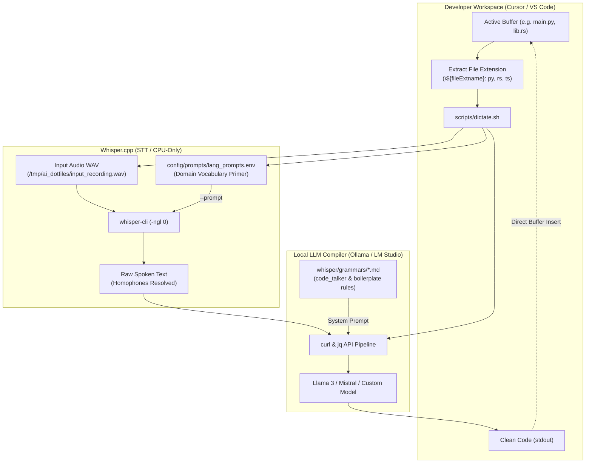

# ai_dotfiles

> Dotfiles and environment configurations for a local and remote Whisper speech-to-text and LLM prompt optimization pipeline.

A special thanks to https://github.com/tavisrudd for their pycon talk in  2013 (during which I was in middle school) showcasing dictation for programming and the state of the art then. This project would not exist if it was not because of you <3.


`ai_dotfiles` provides a modular, reproducible infrastructure for streaming low-latency voice dictation into local or home-server LLM inference pipelines (Ollama / LM Studio), resolving domain homophones with dynamic context switching, and directly injecting optimized code and structured prompts into **Cursor** and **VS Code**.

---

## Architecture Overview



---

## Directory Structure

```text
ai_dotfiles/
├── .env.example               # Full template for local/remote pipeline configurations
├── .gitignore                 # Ignores local secrets, audio buffers, and model weights
├── install.sh                 # Safe, idempotent bootstrap installer & link manager
├── README.md                  # System documentation & setup guide
├── whisper -> config/whisper  # Root symlink for grammar & config discovery
├── prompts -> config/prompts  # Root symlink for language prompts discovery
├── config/
│   ├── whisper/
│   │   ├── whisper.conf       # Audio parameters, thread counts, and model profiles
│   │   └── grammars/          # Spoken grammar specifications in Markdown
│   │       ├── code_talker.md # Casing styles, operators, punctuation, control flow
│   │       └── boilerplate.md # Macros: dates (american date today), templates, git
│   ├── prompts/
│   │   └── lang_prompts.env   # 595 languages & 1,840+ extension/alias Whisper prompts
│   ├── ollama/
│   │   ├── Modelfile.prompt-optimizer  # Custom Modelfile for prompt structuring
│   │   └── system-prompts/
│   │       └── prompt-optimizer.txt    # Token cleaning & code-normalization prompt
│   └── ide/
│       ├── tasks.json         # VS Code / Cursor task passing ${fileExtname}
│       └── keybindings.json   # IDE hotkey mapping (Ctrl+Alt+D)
├── scripts/
│   ├── dictate.sh             # Core dynamic context & LLM piping pipeline (stdout)
│   ├── pipeline/
│   │   └── transcribe_and_optimize.sh # General dictation & clipboard/auto-paste runner
│   └── setup/
│       ├── setup_whisper_cpp.sh       # Automated build & model downloader
│       ├── generate_lang_prompts.py   # Regenerates lang_prompts.env from Linguist
│       └── languages.yml              # Canonical GitHub Linguist language specs
└── systemd/
    └── whisper-server.service.example # Systemd unit file for headless home servers
```

---

## Dynamic Context & Spoken Grammars

### 1. Language-Specific Vocabulary Biasing (`config/prompts/lang_prompts.env`)
Whisper's initial prompt (`-p` / `--prompt`) biases acoustic token probabilities towards programming jargon and symbols. When editing a file in Cursor or VS Code, the extension is detected and the appropriate domain vocabulary is automatically injected.

`config/prompts/lang_prompts.env` provides comprehensive coverage for **all 573 programming languages known to GitHub Linguist** (plus key markup and query languages—595 languages and 1,840+ extension/alias mappings in total). Sourced in under 20ms.

- **Python (`py`, `python`)**: `PROMPT_PY="Python, async, await, def, dict, list, tuple, snake_case, kwargs..."`
- **Rust (`rs`, `rust`)**: `PROMPT_RS="Rust, fn, mut, impl, struct, enum, Result, Option, match, Vec..."`
- **TypeScript (`ts`, `tsx`)**: `PROMPT_TS="TypeScript, interface, type, const, async, await, Promise..."`
- **C / C++ (`c`, `cpp`, `c++`)**: `PROMPT_CPP="C++, cpp, std, vector, auto, template, typename, class..."`
- **C# (`cs`, `c#`)**: `PROMPT_CS="C#, csharp, class, struct, interface, enum, record, namespace, using..."`
- **Zig (`zig`, `zon`)**: `PROMPT_ZIG="Zig, fn, pub, const, var, struct, enum, union, error, try, catch..."`
- **Gleam (`gleam`)**: `PROMPT_GLEAM="Gleam, pub, fn, let, assert, type, opaque, case, of, import..."`
- **Solidity (`sol`, `solidity`)**: `PROMPT_SOL="Solidity, pragma, contract, interface, function, public, private..."`
- **Full Spectrum**: Covers Ada, COBOL, Fortran, Haskell, OCaml, Clojure, Elixir, Julia, R, Lua, PowerShell, SQL, and 500+ more.
- **Fallback**: Unrecognized extensions fall back to `PROMPT_DEFAULT` gracefully.

### 2. Spoken Grammars (`whisper/grammars/*.md`)
Grammars dictate how spoken words translate to syntax, boilerplate, and keywords:

---

## Wake Word Activation & Voice Control

`ai_dotfiles` supports customizable, case-insensitive **Wake Word Detection** with automated prefix stripping.

### Configuration (`.env`)
```bash
# Enable wake word verification
WAKE_WORD_ENABLED=true

# Set your custom wake word or phrase
WAKE_WORD="computer"

# Automatically strip wake word and following punctuation before passing to LLM
WAKE_WORD_STRIP=true
```

### Supported Variations & Features
- **Conversational Fillers**: Naturally tolerates filler prefixes like `"Hey"`, `"Um"`, `"Ok"`, or `"Uh"` (e.g. `"Hey computer, create a table"`).
- **Multiple Alternatives**: Alternate wake words can be separated by a pipe `|`:
  ```bash
  WAKE_WORD="computer|jarvis"
  ```
- **CLI Overrides**:
  ```bash
  # Override or enable wake word on the fly:
  ai-dictate --wake-word "jarvis"

  # Temporarily disable wake word requirement:
  ai-dictate --no-wake-word

  # Run as a continuous hands-free voice daemon:
  ai-dictate --continuous --wake-word "computer"
  ```

---

## Audio Capture & Silence Detection

`ai-dictate` includes an intelligent **Voice Activity & Silence Detection (VAD)** audio recorder (`scripts/audio/record_until_silence.py` / `ai-record`):
- **Runs Until You Stop Speaking**: Dynamically calibrates ambient room noise floor, detects speech onset, buffers the pre-speech audio (preventing first syllable clipping), and automatically ends recording once a configured period of silence is detected (default `1.2s`).
- **Zero ALSA Spam**: Suppresses low-level ALSA driver warnings for clean terminal logging.
- **Backends**: Direct PyAudio stream with automatic fallback to `arecord`, `parecord`, `ffmpeg`, or `sox`.

Configure parameters in `.env`:
```bash
AUDIO_SILENCE_DURATION=5.0     # Silence duration in seconds before finalizing capture
AUDIO_SILENCE_THRESHOLD="2.0%" # Energy threshold (percentage or integer RMS)
AUDIO_LISTEN_TIMEOUT=30        # Max wait time in seconds for initial speech while listening
AUDIO_MAX_DURATION=120         # Maximum safety recording duration (seconds)
```
- **Sci-Fi Single-Syllable Codex (`whisper/grammars/scifi_lexicon.md`)**:
  - Maps **all 1,392 distinct words** from `config/prompts/lang_prompts.env` to strictly single-syllable sci-fi/cybernetic codewords to eliminate recognition slur and speech fatigue during dictation.
  - `test` $\rightarrow$ `if`
  - `shift` $\rightarrow$ `else`
  - `spin` $\rightarrow$ `for`
  - `hold` $\rightarrow$ `while` / `await`
  - `yield` $\rightarrow$ `return`
  - `core` $\rightarrow$ `function` / `def`
  - `spark` $\rightarrow$ `fn` / `lambda`
  - `flux` $\rightarrow$ `var` / mutable
  - `lock` $\rightarrow$ `const` / immutable
  - `bind` $\rightarrow$ `let`
  - `sync` $\rightarrow$ `async`
  - `dock` $\rightarrow$ `import` / `use`
  - `ship` $\rightarrow$ `export`
  - `strand` $\rightarrow$ `string` / `str`
  - `count` $\rightarrow$ `int` / integer
  - `drift` $\rightarrow$ `float` / double
  - `bit` $\rightarrow$ `bool` / boolean
  - `pulse` $\rightarrow$ `true`
  - `dead` $\rightarrow$ `false`
  - `void` $\rightarrow$ `void` / `null` / `None`
  - `hull` $\rightarrow$ `struct`
  - `clan` $\rightarrow$ `class`
  - `port` $\rightarrow$ `interface`
  - Regenerable via `scripts/setup/generate_scifi_grammar.py`; machine-readable lookup at `whisper/grammars/scifi_lexicon.json`.
- **Punctuation & Operators (`code_talker.md`)**:
  - `arrow func` / `fat arrow` $\rightarrow$ `=>`
  - `thin arrow` / `returns` $\rightarrow$ `->`
  - `equals equals` $\rightarrow$ `==` (or `===` in JS/TS)
  - `not equals` $\rightarrow$ `!=`
  - `and and` $\rightarrow$ `&&`
  - `or or` $\rightarrow$ `||`
- **Casing Transformations**:
  - `snake case get user by id` $\rightarrow$ `get_user_by_id`
  - `camel case fetch customer data` $\rightarrow$ `fetchCustomerData`
  - `pascal case auth token provider` $\rightarrow$ `AuthTokenProvider`
  - `constant case max retries` $\rightarrow$ `MAX_RETRIES`
- **Temporal & Boilerplate Macros (`boilerplate.md`)**:
  - `american date today` $\rightarrow$ current date in `MM/DD/YYYY` (e.g. `11/23/2026`)
  - `iso date today` $\rightarrow$ current date in `YYYY-MM-DD`
  - `shebang bash` $\rightarrow$ `#!/usr/bin/env bash\nset -euo pipefail`
  - `python main` $\rightarrow$ `if __name__ == "__main__":`

---

## Prerequisites

| Component | Recommended Tool | Alternative / Notes |
| :--- | :--- | :--- |
| **Audio Capture** | `sox` (with `libsox-fmt-all`) | `ffmpeg` or `arecord` |
| **STT Engine** | `whisper.cpp` (`large-v3-turbo`) | CPU-only (`-ngl 0`); `whisper-base.en` for laptops |
| **LLM Runner** | `ollama` (`llama3:8b-instruct-q8_0`) | LM Studio / Local OpenAI-compatible API |
| **Data Piping** | `jq`, `curl` | Used by `dictate.sh` for API payload formatting |
| **Clipboard / IPC** | `wl-copy` (Wayland) / `xclip` (X11) | `wtype` or `xdotool` for automatic keystroke paste |
| **Core Utilities** | `curl`, `git`, `bash 4.4+` | Standard Linux/POSIX tools |

---

## CPU-Only Optimization (No GPU Required)

The pipeline is pre-configured for pure CPU execution:
1. **Zero GPU Offload**: `WHISPER_N_GPU_LAYERS=0` and `-ngl 0` ensure no CUDA, ROCm, Metal, or Vulkan VRAM allocation occurs.
2. **SIMD Vectorization & OpenMP**: `scripts/setup/setup_whisper_cpp.sh` compiles with `-DGGML_CUDA=OFF -DGGML_OPENMP=ON -DGGML_NATIVE=ON` to utilize native AVX2, FMA, or ARM NEON instructions.
3. **Thread Tuning**: Set `WHISPER_THREADS` in `.env` to match your **physical CPU core count** (e.g., `4` or `8`). Avoid setting threads to logical hyperthread counts, as hyperthreading increases cache thrashing and lowers whisper throughput.
4. **Recommended CPU Models**:
   - `ggml-large-v3-turbo.bin` (Fastest large model on modern x86/ARM CPUs)
   - `ggml-base.en.bin` (Sub-second latency on lightweight CPUs/laptops)
   - Quantized `q5_0` variants (Lower memory bandwidth footprint)

---

## Quickstart Installation

### 1. Clone the Repository
```bash
git clone https://github.com/your-username/ai_dotfiles.git ~/code/ai_dotfiles
cd ~/code/ai_dotfiles
```

### 2. Configure Your Environment
Copy `.env.example` to `.env` and configure paths and endpoints:
```bash
cp .env.example .env
vim .env
```

### 3. Run the Bootstrap Script
Run `install.sh` to verify system dependencies and link configurations:
```bash
chmod +x install.sh
./install.sh
```

Symlinks created:
- `~/.config/ai_dotfiles` $\rightarrow$ `config/`
- `~/.local/bin/ai-dictate` $\rightarrow$ `scripts/pipeline/transcribe_and_optimize.sh`
- `~/.local/bin/ai-dictate-code` $\rightarrow$ `scripts/dictate.sh`

### 4. Build Whisper.cpp and Download Models (Optional)
```bash
chmod +x scripts/setup/setup_whisper_cpp.sh
./scripts/setup/setup_whisper_cpp.sh
```

### 5. Create the Custom Ollama Prompt Optimizer Model
```bash
ollama create prompt-optimizer -f config/ollama/Modelfile.prompt-optimizer
```

---

## IDE & Pipeline Execution

### Dynamic Context Pipeline (`dictate.sh`)
The core script accepts a target file extension, looks up language vocabulary, invokes Whisper with `--prompt`, and pipes the raw text to Ollama/LM Studio for grammar compilation:

```bash
# Transcribe speech for Python and output clean code to stdout:
ai-dictate-code py /tmp/ai_dotfiles/input_recording.wav

# Directly test grammar compiler with raw text (no audio recording needed):
ai-dictate-code --ext py --raw-text "american date today"
# Output: 11/23/2026

ai-dictate-code --ext rs --raw-text "fn snake case calculate total open paren close paren thin arrow Result open angle i32 close angle"
# Output: fn calculate_total() -> Result<i32>
```

### Cursor & VS Code Task Configuration
Copy or symlink the provided `config/ide/tasks.json` into your workspace `.vscode/tasks.json`:

```json
{
  "version": "2.0.0",
  "tasks": [
    {
      "label": "AI: Dictate Code into Active Buffer",
      "type": "shell",
      "command": "${env:HOME}/.local/bin/ai-dictate-code",
      "args": ["${fileExtname}"],
      "presentation": {
        "echo": false,
        "reveal": "never",
        "focus": false,
        "panel": "shared",
        "clear": true
      },
      "problemMatcher": []
    }
  ]
}
```

Bind a shortcut in `keybindings.json` (e.g. `Ctrl+Alt+D`):
```json
[
  {
    "key": "ctrl+alt+d",
    "command": "workbench.action.tasks.runTask",
    "args": "AI: Dictate Code into Active Buffer",
    "when": "editorTextFocus"
  }
]
```

---

## Home Server Daemon Setup (Optional)
For headless home-server setups running `whisper-server`:
```bash
mkdir -p ~/.config/systemd/user/
cp systemd/whisper-server.service.example ~/.config/systemd/user/whisper-server.service
systemctl --user daemon-reload
systemctl --user enable --now whisper-server.service
```

---

## License
MIT License.
